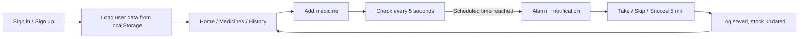

# 💊 MediRemind

> A simple, single-file web app that reminds you to take your medicines, tracks your doses, and warns you when stock runs low.


## Table of Contents

- [Overview](#overview)
- [Features](#features)
- [Screenshots](#screenshots)
- [Technology Stack](#technology-stack)
- [How It Works](#how-it-works)
- [Getting Started](#getting-started)
- [Configuration: Google Sign-In](#configuration-google-sign-in-optional)
- [Usage Guide](#usage-guide)
- [Data and Privacy](#data-and-privacy)
- [Troubleshooting](#troubleshooting)
- [Contributing](#contributing)
- [Author](#author)

## Overview

Missing a dose or running out of medicine unnoticed is a common problem. **MediRemind** lets a user add their medicines with dosage, daily timings and stock count, then rings an alarm at the scheduled time. Each dose can be marked as **Taken** or **Skipped**, and the app keeps a history, a streak counter and low-stock alerts.

The whole application is one self-contained HTML file with no build step, no dependencies and no backend.

## Features

- **Account sign-in** with email and password, with a separate data store per account.
- **Optional Google sign-in** (needs a Google OAuth client ID, see [configuration](#configuration-google-sign-in-optional)).
- **Add medicines** with name, dosage, frequency (once, twice or three times daily), custom reminder times, current stock, low-stock threshold, color tag and special instructions.
- **Home dashboard** with today's date, a progress bar of completed doses, and pending doses grouped into Morning (before 12:00) and Evening.
- **One-tap actions**: *Take Now* or *Skip* on every dose. Taking a dose reduces the stock by one.
- **Stock alerts**: a red *Critical Stock Alert* at 0 left and a yellow *Running Low* alert at or below your threshold.
- **Medicines list** with search, an *All / Low stock* filter and delete with confirmation.
- **History**: current streak, a 30-day taken/skipped bar chart, day-by-day navigation and a per-day activity log.
- **Alarm**: full-screen alert with a repeating beep, device vibration where supported, and a browser notification. You can take, skip or **snooze for 5 minutes**.
- **Responsive layout** with a bottom navigation bar, designed to work on phones and desktops.

## Screenshots

> _Screenshots not added yet._ Place images in a `screenshots/` folder and reference them like this:
>


> ``

## Technology Stack

| Area | Technology |
|------|------------|
| Markup and styling | HTML5, CSS3 (custom properties, flexbox, grid) |
| Logic | Vanilla JavaScript (no frameworks or libraries) |
| Storage | Browser `localStorage` |
| Password hashing | Web Crypto API (SHA-256) |
| Alarm sound | Web Audio API |
| Notifications | Web Notifications API, Vibration API |
| Google sign-in (optional) | Google Identity Services |

## How It Works



The app checks the clock every 5 seconds. When a medicine's time matches the current `HH:MM` and the dose has not been logged yet, the alarm rings.

## Getting Started

### Prerequisites

- A modern web browser (Chrome, Edge, Firefox, Safari).
- No Node.js, package manager or server is required.

### Run locally

1. Download or clone the repository.
2. Open the HTML file (for example `index.html`) in your browser.

Optionally, serve it over `localhost`, which is required for Google sign-in:

```bash
python -m http.server 8000
```

Then open `http://localhost:8000`.

## Configuration: Google Sign-In (optional)

Email and password sign-in works out of the box. To enable Google sign-in, set your OAuth Web client ID in the script section of the HTML file:

```js
const GOOGLE_CLIENT_ID=''; // paste your Google OAuth Web client ID here
```

While this is empty, the *Continue with Google* button shows a message asking you to set the ID. Google sign-in must be opened from `http://localhost` or your own website.

## Usage Guide

1. **Create an account** (or sign in) on the first screen.
2. Tap **+ Add Medicine**, fill in the details and save.
3. Allow notifications when prompted, or tap the 🔔 button on the home screen to enable the alarm and notifications.
4. When the alarm rings, choose **Take Now**, **Snooze 5 min** or **Skip**. You can also mark doses from the home screen.
5. Use **Medicines** to search, filter by low stock or delete a medicine.
6. Use **History** to see your streak, the 30-day chart and past days.
7. Use the ⎋ button on the home screen to sign out.

## Data and Privacy

- All data (accounts, medicines, logs) is stored **only in your browser's `localStorage`**. Nothing is sent to a server.
- Data is separate for each account on the same browser, and clearing site data removes it.
- Passwords are stored as SHA-256 hashes in the same browser storage. This is client-side only and is **not a substitute for secure server-side authentication**.

## Troubleshooting

| Problem | What to try |
|---------|-------------|
| No alarm sound | Browsers block audio until you interact with the page. Click anywhere or tap the 🔔 button once after opening the app. |
| No notification appears | Allow notifications for the site in your browser's site settings. |
| Alarm did not ring | The alarm only works while the page is open in a browser tab. |
| Google button shows a message | Set `GOOGLE_CLIENT_ID` and open the page from `http://localhost` or your website. |
| Data is missing | Data is tied to the browser and account. Check you are signed in to the same account and that site data was not cleared. |

## Contributing

Contributions are welcome.

1. Fork the repository.
2. Create a branch: `git checkout -b feature/your-feature`.
3. Commit your changes and push the branch.
4. Open a pull request describing what you changed.

## Author

**Vyshnavi**

- GitHub: _add your profile link_
- LinkedIn: _add your profile link_
